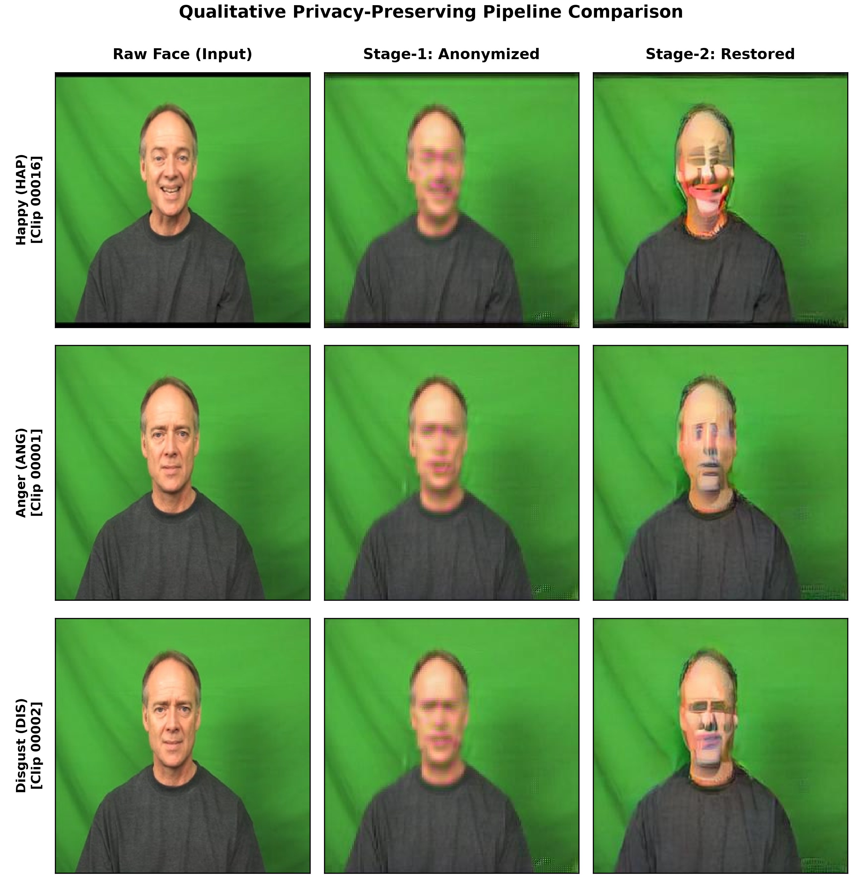
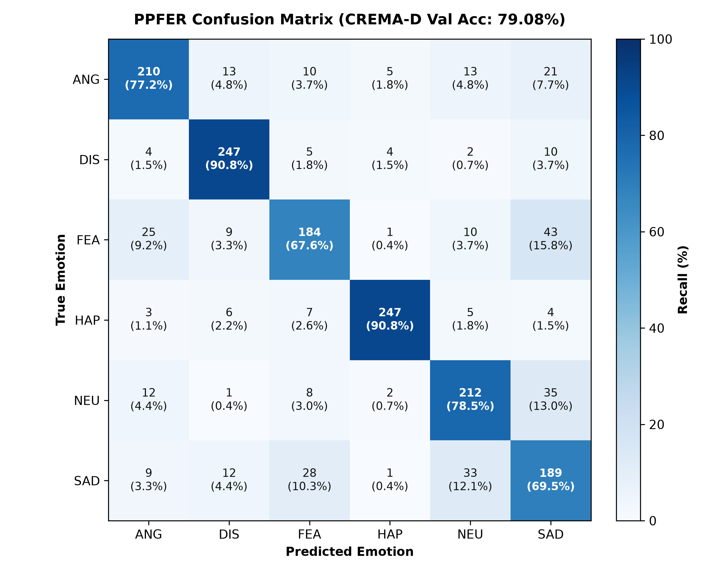
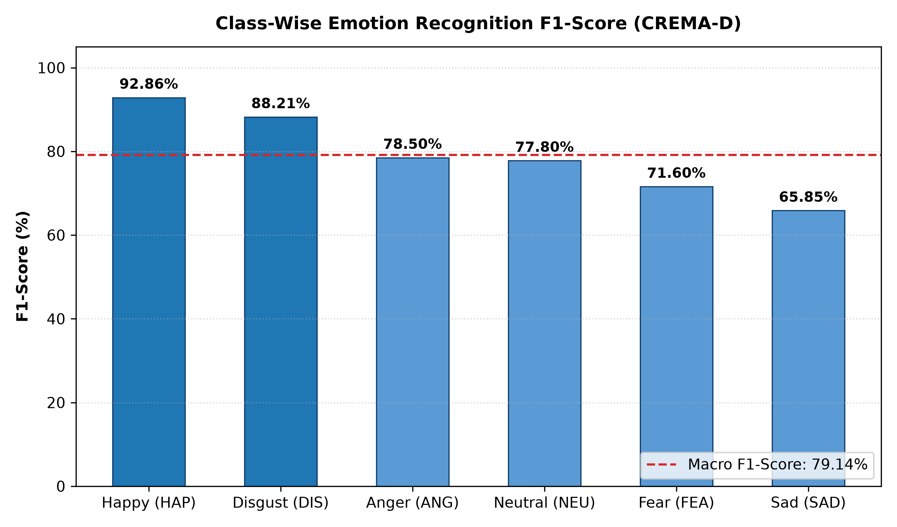

# Privacy-Preserving Facial Expression Recognition (PPFER)

A three-stage deep learning pipeline for privacy-preserving video facial expression recognition using **Frequency Decomposition**, **Latent U-ViT Expression Compensation**, and **3D ResNet-18 Spatio-Temporal Classification**.

## Pipeline Architecture
1. **Stage 1 — Frequency Decomposition (`f_lpr`, `f_hpr`):** Suppresses high-frequency biometric identity textures while preserving low-frequency facial expression dynamics.
2. **Stage 2 — Latent Expression Compensation (`U-ViT` + `Autoencoder KL`):** Restores expression details attenuated during anonymization (`63.25%` validation accuracy).
3. **Stage 3 — Spatio-Temporal Classification (`3D ResNet-18`):** Processes 16-frame video clips (`3 × 16 × 256 × 256`) to classify 6 facial emotions.

## Qualitative Pipeline Comparison

## Quantitative Results (DFEW Pretraining → CREMA-D Evaluation)
- **Overall Validation Accuracy:** `79.08%` (1,630 validation clips across 91 subjects)
- **Macro F1-Score:** `79.14%`
- **Top Performing Classes:** Happy (`92.86%` F1), Disgust (`88.21%` F1)

| Confusion Matrix | Per-Class F1 Performance |
| :---: | :---: |
|  |  |

## Trained Model Checkpoints
> *Google Drive link for `f_hpr_best.pth`, `f_lpr_best.pth`, `s2_best_model.pth`, and `s3_best_model.pth` will be linked here after upload.*

## Phase-II Experimental Roadmap
1. **Fixed Frequency Decomposition:** Comparing deterministic frequency cut-offs against learnable Stage-1 filters.
2. **Open Cross-Dataset Generalization:** Zero-shot evaluation on unseen open benchmarks (RAVDESS / SAVEE / DFEW).
3. **Privacy Auditing (MIA):** Membership Inference Attack evaluation to formally measure privacy resilience.
